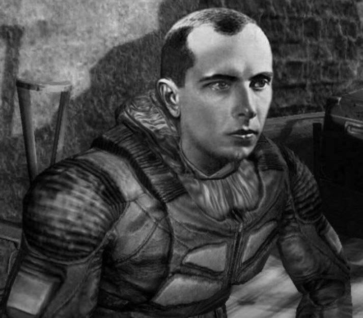

# cop-talker

Українською: [README.md](README.md)

## Requirements

- CoP 1.6.02 (GOG or Steam) with [OpenXRay](https://github.com/OpenXRay/xray-16/wiki/%5BEN%5D-How-to-install-and-play)
- `xukrainian.db` with the Ukrainian voice pack, only for cutting voice samples
- Windows 10/11 and Python 3.10–3.13 (on PATH)
- a Gemini key (free) or a Claude subscription
- ElevenLabs with voice cloning (Starter plan or above)

## What's in it

A mod for S.T.A.L.K.E.R.: Call of Pripyat that lets you talk to NPCs by voice. Look at a stalker, hold T, say something in Ukrainian, and he answers in his own in-game voice.

NPCs answer based on their faction, rank, wounds, the weather, emissions and whatever you talked about before. Memory survives restarts. They also speak up on their own: greetings, reactions when you pick up an artifact or walk into an anomaly, chats with each other. Sometimes they bring up life back home or real news, pulled from the Suspilne, BBC Ukrainian and TSN RSS feeds.

Conversations can change things in the game:
- a gesture;
- following you or staying put;
- turning hostile or becoming a friend;
- selling or buying an item, handing over money;
- taking a paid hit. If the target is far away, the killer's squad goes looking for him.

There's Twitch support. Chat messages starting with `$` are said word for word, and messages starting with `%` are retold in the NPC's own words. Each viewer sticks to one NPC, and their nick shows next to his name when you look at him.

## How it works

Two parts: a Lua script in the game (`mod\gamedata`) and a Python app (`companion\`). They talk through files in `<game>\talker\`:
- the game writes `state.json` (who's around, the player, the level) and `events.jsonl` (what happened);
- the app writes `inbox.txt` (what to say and do).

The app transcribes your speech, asks an LLM for a reply, voices it with ElevenLabs and plays it with distance-based volume. The game shows subtitles, moves the NPC's mouth and carries out actions.

Besides `talker_bridge.script`, the mod touches 6 original game scripts, adding a one-line hook to each (see `tools\patch_hooks.py`).

Built with:
- [OpenXRay](https://github.com/OpenXRay/xray-16)
- Claude Haiku (through Claude Code or the API) or Gemini. If Claude doesn't answer, Gemini takes over.
- faster-whisper `large-v3-turbo` locally for speech recognition, or Gemini
- ElevenLabs `eleven_v3`, with voices cloned from the game's Ukrainian dub
- PySide6 for the window, sounddevice/soundfile for audio
- Twitch EventSub

## Install

1. Download the repo anywhere.
2. Run `setup.bat`. It:
   - installs dependencies into `.venv`;
   - asks where the game is;
   - copies the mod into `gamedata`;
   - creates `.env`;
   - adds a desktop shortcut;
   - optionally cuts voice samples into `samples\`.
3. Fill in `.env`:
   - `GEMINI_API_KEY` (https://aistudio.google.com/apikey)
   - `ELEVENLABS_API_KEY`
   - `VOICE_HUMAN_01`, `02`, `03`. These are clone Voice IDs: in ElevenLabs go to Voices → Instant Voice Clone, upload `samples\human_0N_ukr.mp3`, copy the ID. Faction voices are optional.
4. To use Claude instead of Gemini:
   - install Claude Code;
   - run `claude` and `/login`;
   - set `LLM_PROVIDER=claude` in `settings.ini`.
5. Start the game, load a save, open StalkerTalker from the desktop.

## Keys

- T (hold): talk
- Y: the NPC follows you
- U: the NPC stays put

You can rebind them in `gamedata\configs\scripts\talker.ltx`. Everything else is in the Settings tab (which is just `settings.ini`).

To connect Twitch:
1. Register an app on dev.twitch.tv (Public type).
2. Put the Client ID in `.env` (`TWITCH_CLIENT_ID`).
3. Put your channel in `TWITCH_CHANNEL`.
4. In the window, click Twitch → Authorize.

## Updating and removing

After changing anything in `mod\`, run `install_mod.ps1` and reload your save, since the game only reads scripts on load. The app tells you if the game is still running an older script.

To remove the mod from the game, run `uninstall_mod.ps1`.

`.env`, logs, NPC memory and the Twitch token stay out of the repo. Don't share your `.env`.

## License

MIT, see [LICENSE](LICENSE). Except the 6 original game scripts in `mod\gamedata\scripts` (all but `talker_bridge.script`): they belong to GSC Game World and are included only with the hooks added.
